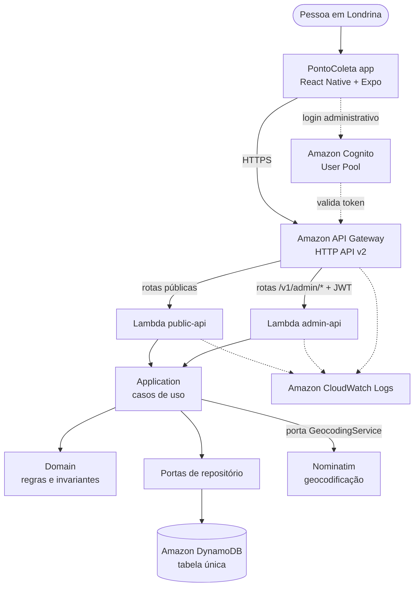
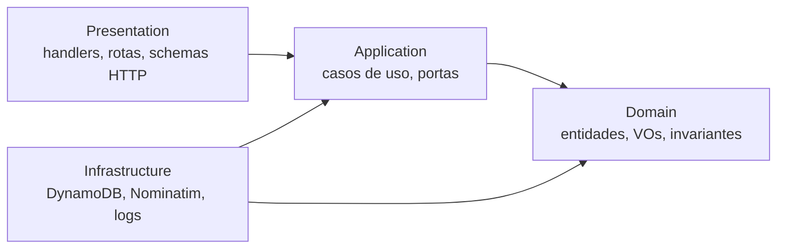
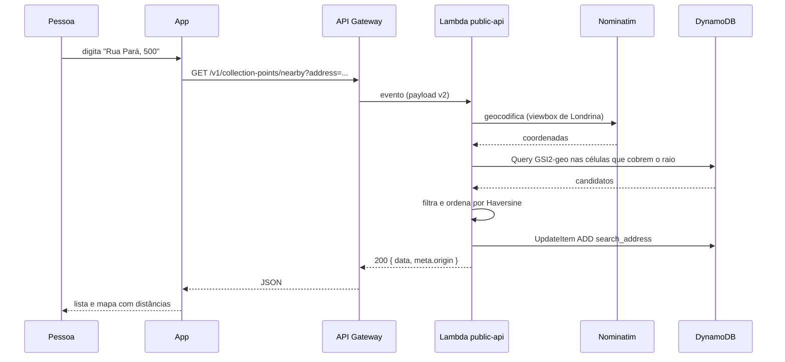

# Arquitetura

Este documento descreve a arquitetura **implementada**, não uma intenção.

## Visão geral



Nada no app fala diretamente com o DynamoDB. A única porta de entrada dos dados
é o API Gateway.

## Camadas

O backend segue DDD pragmático ([ADR-001](decisions/ADR-001-ddd-pragmatico.md)),
organizado por módulo de negócio antes de por tipo técnico.



A seta de `Infrastructure` aponta **para dentro**: a infraestrutura implementa
interfaces declaradas no domínio e na aplicação. O domínio não importa AWS SDK,
HTTP, Terraform, Expo nem React Native.

| Camada             | Responsabilidade                                          | Exemplos                                                                 |
| ------------------ | --------------------------------------------------------- | ------------------------------------------------------------------------ |
| **Domain**         | Conceitos e regras que existiriam sem computador           | `CollectionPoint`, `Material`, `Coordinates`, `SERVICE_AREA`, Haversine   |
| **Application**    | Orquestração de um caso de uso, dependendo só de abstrações| `CreateCollectionPoint`, `SearchCollectionPointsByLocation`               |
| **Infrastructure** | Implementações concretas                                   | `DynamoCollectionPointRepository`, `NominatimGeocodingService`, logger    |
| **Presentation**   | Contrato HTTP, validação estrutural, códigos de status     | `collection-point-routes.ts`, `error-mapper.ts`, `Router`                 |

## Módulos

```text
backend/src/
├── modules/
│   ├── collection-points/    domain · application · infrastructure · presentation
│   └── metrics/              domain · application · infrastructure · presentation
├── shared/
│   ├── domain/               erros, geohash, Haversine, normalização de texto
│   ├── application/          portas Clock, IdGenerator, Logger
│   ├── infrastructure/       config, cliente DynamoDB, logger, composition root
│   └── presentation/         router, respostas, mapeamento de erros, adapter Lambda
└── handlers/                 public-api.ts, admin-api.ts
```

### Como os módulos se falam

`collection-points` precisa contar cadastros e buscas, mas não conhece o módulo
de métricas. Ele declara a porta `UsageMetricRecorder`; o adaptador
`UsageMetricRecorderAdapter` liga essa porta ao caso de uso
`RegisterUsageMetric`; a ligação acontece no composition root. Registrar métrica
nunca derruba a operação medida: falha é logada em `warn` e engolida.

## Lambdas

Duas funções ([ADR-005](decisions/ADR-005-http-api-e-duas-lambdas.md)):

| Função       | Memória | Timeout | Permissões DynamoDB                              |
| ------------ | ------- | ------- | ------------------------------------------------ |
| `public-api` | 512 MB  | 15 s    | GetItem, BatchGetItem, Query, PutItem, UpdateItem |
| `admin-api`  | 256 MB  | 10 s    | Query                                            |

Ambas em `arm64` (Graviton, ~20% mais barato) e runtime `nodejs22.x`. O
container é construído uma vez por container (fora do handler), então clientes
HTTP e DynamoDB são reaproveitados entre invocações.

## Mobile

```text
mobile/
├── app/                      rotas (Expo Router)
│   ├── _layout.tsx           providers + navegação
│   ├── index.tsx             Home
│   ├── results.tsx           resultados (lista ↔ mapa)
│   ├── point/[id].tsx        detalhes
│   ├── new-point.tsx         cadastro
│   └── admin/index.tsx       login + métricas
└── src/
    ├── design-system/        tokens + componentes
    ├── features/             collection-points, admin
    ├── services/             apiClient, config, metrics
    ├── schemas/              validação de formulário (zod)
    ├── hooks/                utilidades de UI
    └── utils/                formatação pt-BR
```

Separação de estado:

- **Estado de servidor** — TanStack Query. Cache, `loading`/`error`/`empty`,
  retry e invalidação após cadastro. Nunca copiado para `useState`.
- **Estado de UI** — `useState` local (texto digitado, aba lista/mapa, seleção
  no mapa).

Não há store global: nenhuma tela precisa de estado compartilhado que já não
esteja no cache de queries ou na URL.

## Fluxo de uma busca por endereço



## Serviços externos

| Serviço                     | Uso                          | Onde fica isolado                        |
| --------------------------- | ---------------------------- | ---------------------------------------- |
| Nominatim (OpenStreetMap)   | endereço → coordenadas       | `NominatimGeocodingService` (porta)      |
| Google Maps (Android)       | renderização do mapa         | `CollectionPointsMap`                    |
| Google AdMob                | banner discreto              | `BannerAdSlot`                           |
| Amazon Cognito              | login administrativo         | `features/admin/auth.ts`                 |

Cada um está atrás de um único arquivo. Trocar qualquer um deles é uma mudança
local.

## Infraestrutura

Toda a infraestrutura é declarada em Terraform e **nada foi provisionado**. Ver
[terraform.md](terraform.md) e [deployment.md](deployment.md).

```text
modules/stack
├── modules/dynamodb      tabela + GSI1 (status) + GSI2 (geohash, esparso)
├── modules/lambda   ×2   função + role + policy mínima + log group
├── modules/http-api      API + estágio + rotas + integrações + authorizer JWT
└── modules/admin-auth    user pool + app client
```
