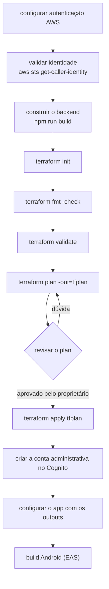

# Deploy

> **Este documento descreve um processo FUTURO.**
>
> Nenhum recurso AWS foi criado, alterado ou removido. `terraform plan` está
> pendente por ausência deliberada de credenciais e `terraform apply` **não deve
> ser executado** sem revisão do plan e autorização explícita do proprietário.

## Ordem geral



## 1. Autenticação AWS

Escolha **um** mecanismo. Credenciais nunca entram em `.tf`, `.tfvars` ou no Git.

**AWS SSO (recomendado)**

```bash
aws configure sso --profile pontocoleta-dev
aws sso login --profile pontocoleta-dev
```

**Profile com chave de acesso**

```bash
aws configure --profile pontocoleta-dev
```

**Variáveis de ambiente** (útil em CI)

```bash
export AWS_ACCESS_KEY_ID=...
export AWS_SECRET_ACCESS_KEY=...
export AWS_SESSION_TOKEN=...
export AWS_REGION=sa-east-1
```

Recomendação: um profile por ambiente, e ambientes em contas AWS diferentes se
possível — é o isolamento mais forte que existe.

## 2. Validar a identidade

Sempre antes de planejar, para não aplicar na conta errada:

```bash
aws sts get-caller-identity --profile pontocoleta-dev
```

Confira `Account` e a região.

## 3. (Opcional) Backend remoto de state

Recomendado antes do primeiro apply de produção.

```bash
cd infrastructure/terraform/bootstrap
cp terraform.tfvars.example terraform.tfvars   # ajuste o nome do bucket
terraform init
terraform plan
terraform apply            # cria APENAS o bucket de state
```

Depois, para cada ambiente:

```bash
cd ../environments/prod
mv backend.tf.example backend.tf   # ajuste <account-id>
terraform init -migrate-state
```

## 4. Construir o backend

O Terraform não compila TypeScript. Sem este passo, o `archive_file` falha.

```bash
npm --prefix backend run verify   # lint + typecheck + testes + build
```

Produz `backend/dist/lambdas/public-api/` e `backend/dist/lambdas/admin-api/`.

## 5. Planejar

```bash
cd infrastructure/terraform/environments/dev
cp terraform.tfvars.example terraform.tfvars    # ajuste região e User-Agent

export AWS_PROFILE=pontocoleta-dev
terraform init
terraform fmt -check
terraform validate
terraform plan -out=tfplan
```

### O que revisar no plan

- Contagem: o primeiro apply de um ambiente cria por volta de 20 recursos
  (tabela, 2 funções, 2 roles, 2 policies, 3 log groups, API, estágio,
  2 integrações, 8 rotas, authorizer, 2 permissões, user pool, app client).
- Nenhum `destroy` ou `replace` inesperado.
- Nomes com o prefixo do ambiente correto (`pontocoleta-dev-*`).
- Região correta.
- Nenhum valor sensível no plan.

## 6. Aplicar

> Só após a revisão acima e a autorização explícita do proprietário.

```bash
terraform apply tfplan
terraform output
```

Guarde os outputs: `api_endpoint`, `admin_user_pool_id`, `admin_client_id`,
`table_name`, `log_groups`.

## 7. Criar a conta administrativa

O Terraform não cria o usuário: senha não pertence ao state.

```bash
aws cognito-idp admin-create-user \
  --user-pool-id <admin_user_pool_id> \
  --username admin@seu-dominio.com \
  --user-attributes Name=email,Value=admin@seu-dominio.com Name=email_verified,Value=true \
  --profile pontocoleta-dev

# define a senha definitiva (evita o desafio de troca no primeiro login)
aws cognito-idp admin-set-user-password \
  --user-pool-id <admin_user_pool_id> \
  --username admin@seu-dominio.com \
  --password '<senha-forte>' \
  --permanent \
  --profile pontocoleta-dev
```

Em produção o pool exige MFA: conclua o registro do autenticador pelo console na
primeira vez.

## 8. Apontar o app para o ambiente

`mobile/.env` (ou variáveis do perfil no `eas.json`):

```bash
EXPO_PUBLIC_API_URL=<api_endpoint>
EXPO_PUBLIC_COGNITO_REGION=<região>
EXPO_PUBLIC_COGNITO_CLIENT_ID=<admin_client_id>
```

Verificação rápida:

```bash
curl "<api_endpoint>/v1/health"
```

## 9. Build Android

Ver [play-store.md](play-store.md).

## Atualizações posteriores

```bash
npm --prefix backend run verify
cd infrastructure/terraform/environments/<env>
terraform plan -out=tfplan
terraform apply tfplan
```

Só o código mudou? O plan mostrará apenas `aws_lambda_function` com
`source_code_hash` novo.

## Rollback

- **Código da Lambda:** volte o commit, reconstrua, planeje e aplique.
- **Infraestrutura:** reverta o `.tf`, planeje e aplique. Prefira sempre voltar
  pelo Terraform, não pelo Console.
- **Dados:** em produção o point-in-time recovery permite restaurar a tabela até
  35 dias atrás — a restauração cria uma tabela nova, que precisa ser importada
  para o state ou usada como origem de migração.

## Cuidados

- `terraform destroy` em produção é destrutivo e está bloqueado por
  `deletion_protection_enabled` na tabela. Não desligue essa proteção para
  "resolver" um destroy.
- A URL do API Gateway já está embutida em builds distribuídos: mudar de
  ambiente exige nova build.
- Aplique sempre em `dev` antes de `prod`.
