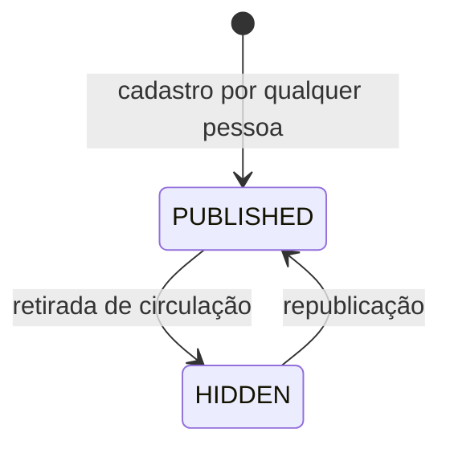
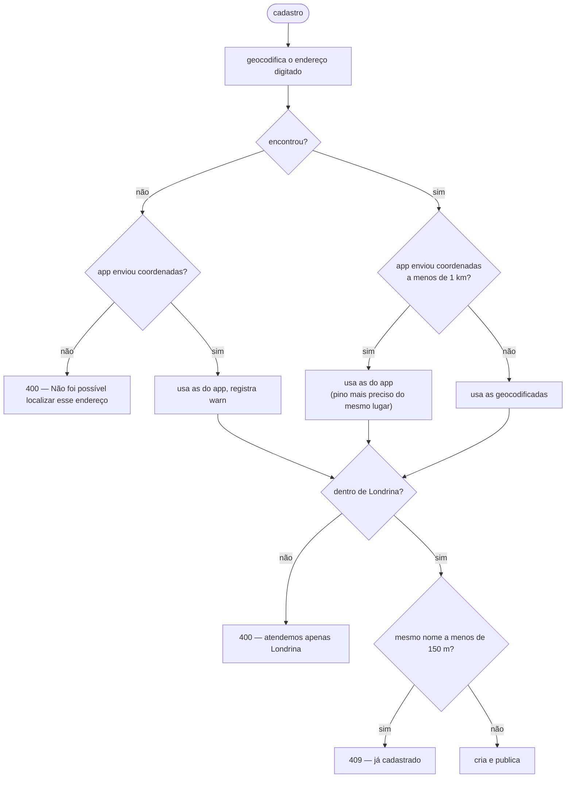
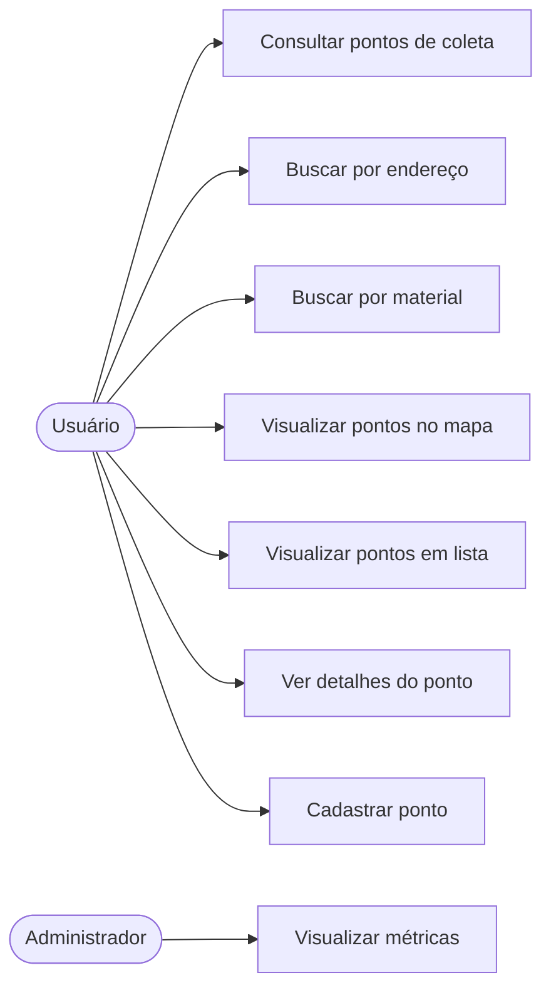

# Domínio

## Ubiquitous Language

Termos usados no código (em inglês) e na interface (em português). Quando os
dois aparecem, o primeiro é o nome no código.

| Termo                                  | Significado                                                                                                    |
| -------------------------------------- | -------------------------------------------------------------------------------------------------------------- |
| **Collection Point** / ponto de coleta | Local físico que recebe materiais para descarte adequado. É o agregado central do produto.                       |
| **Material**                           | Aquilo que um ponto aceita ("Pilhas", "Óleo de cozinha"). Tem um rótulo digitado e um **slug** normalizado.       |
| **Slug**                               | Forma normalizada de um material, usada como chave: minúsculo, sem acento, com hífens. "Óleo" → `oleo`.           |
| **Address** / endereço                 | Linha de endereço livre, mais cidade e estado da área de atendimento.                                            |
| **Coordinates** / coordenadas          | Latitude e longitude validadas, com 6 casas decimais.                                                            |
| **Service Area** / área de atendimento | Londrina/PR: o recorte do produto. Define a partição da tabela, o viés da geocodificação e o que é aceito.        |
| **Opening Hours** / horário            | Texto livre que descreve quando o ponto funciona.                                                                |
| **Status**                             | `PUBLISHED` ou `HIDDEN`. Define se o ponto aparece nas buscas.                                                   |
| **Search** / consulta                  | Uma busca por endereço ou por material. Contada como métrica quando o backend a executa com sucesso.             |
| **Usage Metric** / métrica de uso      | Contador diário e anônimo de um tipo de evento.                                                                  |
| **Metric Day** / dia                   | Bucket diário no fuso de Londrina (UTC−3), não em UTC.                                                           |

## Agregado: CollectionPoint

`backend/src/modules/collection-points/domain/collection-point.ts`

| Campo           | Tipo                     | Invariante                                       |
| --------------- | ------------------------ | ------------------------------------------------ |
| `id`            | string                   | atribuído na criação, imutável                   |
| `name`          | string                   | 3–120 caracteres, espaços colapsados             |
| `address`       | `Address`                | linha de 5–200 caracteres                        |
| `coordinates`   | `Coordinates`            | dentro das faixas válidas; resolvido pelo backend|
| `materials`     | `Material[]`             | 1–10, sem duplicatas por slug                    |
| `openingHours`  | `OpeningHours`           | até 120 caracteres, ou "não informado"           |
| `notes`         | `Notes`                  | até 500 caracteres, ou vazio                     |
| `status`        | `CollectionPointStatus`  | `PUBLISHED` na criação                           |
| `createdAt`     | Date                     | definido na criação                              |
| `updatedAt`     | Date                     | atualizado a cada transição de status            |

Comportamento (não getters): `acceptsMaterial(texto)`, `distanceKmTo(coords)`,
`hide(agora)`, `publish(agora)`, `isPubliclyVisible`.

### Invariantes que o agregado protege

1. Um ponto sem material não existe — não haveria o que descartar nele.
2. Materiais duplicados em grafias diferentes são o mesmo material.
   `["Baterias", "baterias", "BATERIAS"]` vira um só, preservando a primeira
   grafia digitada.
3. Nome vazio ou de duas letras não identifica um lugar.
4. `hide()`/`publish()` são idempotentes: repetir não altera `updatedAt`.
5. Um ponto oculto é, para o público, indistinguível de inexistente (404).

## Value Objects

Criados apenas onde protegem uma invariante ou carregam comportamento —
não há wrapper trivial ([ADR-001](decisions/ADR-001-ddd-pragmatico.md)).

### `Material`

Guarda rótulo e slug juntos. É o que faz a busca funcionar independentemente de
acento, caixa ou espaçamento.

```text
"Baterias"          → slug "baterias"
"Óleo de cozinha"   → slug "oleo-de-cozinha"
"  LÂMPADAS  "      → slug "lampadas",  rótulo "LÂMPADAS"
"Pilhas/Baterias"   → slug "pilhas-baterias"
"!!!"               → rejeitado
```

A lista `SUGGESTED_MATERIALS` (Pilhas, Baterias, Eletrônicos, Lâmpadas, Óleo de
cozinha, Medicamentos, Vidro, Papel, Plástico, Metal) é uma conveniência da
interface, **não** um conjunto fechado: qualquer material pode ser cadastrado.

### `Coordinates`

Valida faixas, arredonda para 6 casas (~11 cm — mais precisão do que o produto
precisa e estável entre provedores de geocodificação) e calcula distância por
Haversine.

### `Address`

Normaliza espaços e monta a forma completa sem duplicar a cidade:

```text
"Rua Pará, 500"            → "Rua Pará, 500, Londrina, PR"
"Rua Pará, 500, Londrina"  → "Rua Pará, 500, Londrina"
```

### `OpeningHours` e `Notes`

Texto livre com limite e estado explícito de "não informado". Um horário
estruturado por dia da semana foi recusado deliberadamente: contribuintes
digitam o que está escrito na porta, e um modelo rígido rejeitaria respostas
válidas ou induziria respostas erradas.

## Status e transições



Só existem dois estados, e a razão é de produto: uma fila de moderação que
ninguém foi designado para revisar deixaria o app vazio e inútil. `HIDDEN` existe
para tirar de circulação um ponto errado ou duplicado sem apagar seu histórico.

Efeitos de `HIDDEN`:

- some das buscas por material, por proximidade e da listagem;
- `GET /v1/collection-points/{id}` responde 404;
- perde os atributos do índice geográfico (índice esparso).

## Área de atendimento

`SERVICE_AREA` (Londrina/PR) é regra de negócio, não configuração:

- define a partição `CITY#LONDRINA` da tabela;
- restringe a geocodificação (`viewbox` + `bounded`);
- rejeita cadastro fora do município;
- limita o raio de busca a 20 km (padrão 5 km).

Atender outra cidade é uma decisão de produto, não uma variável de ambiente.

## Casos de uso

### collection-points

| Caso de uso                        | Entrada                          | Regras próprias                                                                                  |
| ---------------------------------- | -------------------------------- | ------------------------------------------------------------------------------------------------ |
| `CreateCollectionPoint`            | nome, endereço, materiais, etc.  | geocodifica, valida área, detecta duplicata, publica, conta métrica                                |
| `GetCollectionPoint`               | id                               | ponto oculto responde como inexistente                                                             |
| `ListCollectionPoints`             | limite, cursor                   | só publicados, mais recentes primeiro                                                              |
| `SearchCollectionPointsByMaterial` | texto do material                | normaliza para slug antes de consultar; conta métrica                                              |
| `SearchCollectionPointsByLocation` | endereço **ou** lat/lng, raio    | GPS nunca obrigatório; limita o raio; ordena por distância; conta métrica                           |

#### Resolução de coordenadas no cadastro

O backend é a fonte de verdade:



### metrics

| Caso de uso           | Entrada                | Comportamento                                                             |
| --------------------- | ---------------------- | ------------------------------------------------------------------------- |
| `RegisterUsageMetric` | tipo, data opcional    | incrementa o contador do dia (UTC−3) de forma atômica                     |
| `GetUsageMetrics`     | período ou nº de dias  | devolve série contínua, preenchendo com zero os dias sem atividade        |

## Erros de domínio

| Erro                    | Código                    | HTTP | Quando                                        |
| ----------------------- | ------------------------- | ---- | --------------------------------------------- |
| `ValidationError`       | `VALIDATION_ERROR`        | 400  | invariante violada                            |
| `AddressNotFoundError`  | `ADDRESS_NOT_FOUND`       | 404  | endereço não geocodificável                   |
| `NotFoundError`         | `NOT_FOUND`               | 404  | ponto inexistente ou oculto                   |
| `ConflictError`         | `CONFLICT`                | 409  | ponto duplicado                               |
| `ExternalServiceError`  | `EXTERNAL_SERVICE_ERROR`  | 503  | provedor externo indisponível                 |

Mensagens de erro de domínio são escritas para quem usa o app, em português, e
podem ser exibidas diretamente.

## Casos de uso do produto (UML)



Todos os oito estão implementados. Nenhum caso de uso foi acrescentado ou
removido em relação ao planejamento; a única precisão a registrar é que
"Consultar pontos de coleta" é atendido pela listagem e pelos dois modos de
busca, e que o administrador **apenas** consulta métricas — ele não gerencia
pontos nem usuários.
