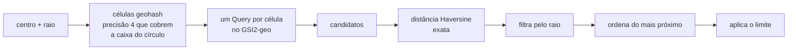

# Modelagem DynamoDB

Tabela única por ambiente: `pontocoleta-dev`, `pontocoleta-prod`.
Modo `PAY_PER_REQUEST`. Decisões e alternativas em
[ADR-002](decisions/ADR-002-dynamodb-single-table-e-proximidade.md).

## Chaves e índices

| Elemento     | Chave de partição | Chave de ordenação          | Projeção | Observação                         |
| ------------ | ----------------- | --------------------------- | -------- | ---------------------------------- |
| Tabela       | `PK`              | `SK`                        | —        | —                                  |
| `GSI1-status`| `GSI1PK`          | `GSI1SK`                    | ALL      | presente em todo ponto             |
| `GSI2-geo`   | `GSI2PK`          | `GSI2SK`                    | ALL      | **esparso**: só pontos publicados  |

## Tipos de item

### 1. Ponto de coleta

```text
PK      = CITY#LONDRINA
SK      = POINT#<id>
GSI1PK  = STATUS#PUBLISHED | STATUS#HIDDEN
GSI1SK  = <createdAt ISO>#<id>
GSI2PK  = GEO#<geohash precisão 4>      ← ausente quando HIDDEN
GSI2SK  = POINT#<id>                     ← ausente quando HIDDEN
```

Atributos: `entityType`, `id`, `name`, `addressLine`, `addressCity`,
`addressState`, `latitude`, `longitude`, `geohash` (precisão 9), `materials`
(lista de `{label, slug}`), `openingHours`, `notes`, `status`, `createdAt`,
`updatedAt`.

Exemplo:

```json
{
  "PK": "CITY#LONDRINA",
  "SK": "POINT#0f2c…",
  "entityType": "CollectionPoint",
  "name": "Ecoponto Centro",
  "addressLine": "Rua Pará, 500",
  "addressCity": "Londrina",
  "addressState": "PR",
  "latitude": -23.3103,
  "longitude": -51.1628,
  "geohash": "6ggez2xkb",
  "materials": [{ "label": "Pilhas", "slug": "pilhas" }],
  "openingHours": "Seg a Sex, 8h às 18h",
  "notes": null,
  "status": "PUBLISHED",
  "GSI1PK": "STATUS#PUBLISHED",
  "GSI1SK": "2026-08-22T12:00:00.000Z#0f2c…",
  "GSI2PK": "GEO#6gge",
  "GSI2SK": "POINT#0f2c…"
}
```

### 2. Item auxiliar de material

Um por material aceito. É o que transforma "quem aceita pilhas?" em um `Query`.

```text
PK  = CITY#LONDRINA
SK  = MATERIAL#<slug>#POINT#<id>
```

Atributos: `entityType`, `pointId`, `materialSlug`, `createdAt`.

O ponto e todos os seus itens auxiliares são gravados em uma única
`TransactWriteItems`: um ponto nunca fica visível sem ser localizável por
material.

### 3. Item de unicidade

Um por ponto. É a **garantia transacional** contra cadastro duplicado: a chave
deriva do slug do nome mais a célula geohash de precisão 7 (cerca de 153 m x
140 m na latitude de Londrina, a mesma escala do raio de 150 m usado na
verificação prévia).

```text
PK  = CITY#LONDRINA
SK  = UNIQUE#POINT#<slug do nome>#<geohash precisão 7>
```

Atributos: `entityType`, `pointId`, `nameSlug`, `geohashCell`, `createdAt`.

Vai na **mesma** `TransactWriteItems` do ponto e dos itens de material, e é o
único dos três com `ConditionExpression: attribute_not_exists(PK)`. De dois
cadastros simultâneos do mesmo lugar, só o primeiro comita; o segundo é
cancelado pelo banco e o repositório traduz a cancelação para `ConflictError`
(409, "Esse ponto de coleta já está cadastrado.").

A verificação prévia por proximidade continua existindo, para a pessoa receber
409 rápido no caso comum sem pagar uma transação. A diferença é que ela deixou
de ser a única barreira.

**Limite conhecido.** Célula é caixa, não círculo: dois cadastros do mesmo nome a
poucos metros um do outro, mas em lados opostos de uma borda de célula, recebem
chaves diferentes e ambos passam. Isso acontece quando as coordenadas vêm do GPS
do aparelho e não do geocodificador — pelo mesmo endereço, o geocodificador
devolve as mesmas coordenadas e a célula é a mesma. Reduzir essa brecha exigiria
gravar uma claim por célula vizinha (nove itens por ponto), o que não se paga
enquanto o caso dominante é o endereço geocodificado.

### 4. Métricas diárias

```text
PK = METRICS#<AAAA-MM>
SK = DATE#<AAAA-MM-DD>
```

Atributos: `entityType`, `date` e um contador numérico por tipo de evento
(`app_open`, `search_address`, `search_material`, `point_created`,
`point_viewed`), incrementados com `ADD` — atômico entre invocações
concorrentes. Eventos individuais **nunca** são armazenados.

### 5. Feedback

```text
PK = FEEDBACK#<AAAA-MM>
SK = AT#<ISO-8601>#<id>
```

Atributos: `entityType`, `feedbackId`, `author` (`Anônimo` quando não informado),
`message` e `submittedAt`. Partição por mês pelo mesmo motivo das métricas: a
contagem de itens por partição não cresce para sempre. A chave de ordenação
começa pelo instante, então ler um mês já sai em ordem cronológica.

Não grava atributo de GSI nenhum: os dois índices são esparsos, logo o feedback
fica fora dos dois e não custa escrita de índice.

A leitura é só da área administrativa e caminha para trás: consulta o mês
corrente em ordem decrescente e, se a página não encheu, segue para o mês
anterior. O passado não tem fim, então uma única requisição caminha no máximo
**12 meses** — sem esse teto, uma listagem de meses vazios consultaria partições
para sempre. Feedback mais antigo que isso continua na tabela, só não aparece na
listagem.

## Access patterns

| Access pattern                 | Estratégia                                                                                          | Operação                    |
| ------------------------------ | --------------------------------------------------------------------------------------------------- | --------------------------- |
| Obter ponto por ID             | chave primária `CITY#LONDRINA` + `POINT#<id>`                                                          | `GetItem`                   |
| Listar pontos de Londrina      | `GSI1-status` com `GSI1PK = STATUS#PUBLISHED`, `ScanIndexForward = false`                              | `Query`                     |
| Buscar por material            | tabela principal, `PK = CITY#LONDRINA` + `begins_with(SK, "MATERIAL#<slug>#POINT#")` → ids → itens      | `Query` + `BatchGetItem`    |
| Buscar por status              | `GSI1-status` com `GSI1PK = STATUS#<status>`                                                           | `Query`                     |
| Buscar por proximidade         | `GSI2-geo`, uma consulta por célula que cobre o círculo, depois filtro/ordenação por Haversine          | `Query` × N (N ≤ 9)         |
| Cadastrar ponto                | ponto + itens de material + item de unicidade com `attribute_not_exists`                               | `TransactWriteItems`        |
| Registrar métrica              | `PK = METRICS#<mês>`, `SK = DATE#<dia>`, `ADD <tipo> :1`                                                | `UpdateItem`                |
| Consultar métricas por período | um `Query` por mês do período, `SK BETWEEN`                                                            | `Query` × meses (≤ 13)      |
| Registrar feedback             | `PK = FEEDBACK#<mês>`, `SK = AT#<instante>#<id>`, com `attribute_not_exists`                            | `PutItem`                   |
| Ler feedback (administrativo)  | `PK = FEEDBACK#<mês>` em ordem decrescente, caminhando para o mês anterior enquanto a página não enche    | `Query` × meses (≤ 12)      |

**Nenhum caminho de leitura usa `Scan`.** Há um teste que verifica isso
(`tests/infrastructure/dynamo-collection-point-repository.test.ts`).

## Busca por proximidade



**Algoritmo.** Geohash base32 próprio (`shared/domain/geo/geohash.ts`, validado
contra o valor de referência `u4pruydqqvj` da especificação original) para
particionar, e Haversine (`shared/domain/geo/haversine.ts`) para a distância
final.

**Precisão.** Uma célula de precisão 4 mede aproximadamente 39 km × 20 km; na
latitude de Londrina, cerca de 36 km × 20 km. O município inteiro cabe em poucas
células, então o conjunto de cobertura é o centro mais um anel — no máximo nove
consultas — para qualquer raio até 19,5 km.

**Precisão da distância.** Haversine assume Terra esférica; o erro é inferior a
0,5%, ou seja, menos de 25 m em 5 km. Irrelevante para "qual ponto está mais
perto".

**Índice esparso.** `GSI2PK` só é gravado para pontos publicados, então nenhuma
consulta de proximidade precisa filtrar status.

**Trade-offs e limites**

- Uma célula de precisão 4 concentra os pontos de toda a cidade em uma partição.
  Para o volume esperado (dezenas a milhares de pontos) isso é adequado; se a
  base crescer muito, o caminho é aumentar a precisão para 5 e ajustar o número
  de anéis — o `geohash` de precisão 9 já está gravado em cada item justamente
  para permitir esse reparticionamento sem geocodificar de novo.
- O raio máximo é 20 km (`SERVICE_AREA.maxSearchRadiusKm`); acima disso a busca
  sairia da área de atendimento.
- Os candidatos de cada célula são carregados na Lambda antes do filtro. Com o
  volume de uma cidade isso é barato; se deixar de ser, o passo seguinte é
  paginar por célula.

## Busca por material


A normalização acontece no domínio, então a mesma regra vale para quem cadastra
e para quem busca.

## Diferenças em relação ao planejamento inicial

O planejamento previa apenas:

```text
PK = CITY#LONDRINA
SK = POINT#<id>
```

Isso foi **mantido** para o item do ponto. O que foi acrescentado, e por quê:

| Acréscimo                        | Problema que resolve                                             | Alternativa descartada                              |
| -------------------------------- | ---------------------------------------------------------------- | --------------------------------------------------- |
| Itens `MATERIAL#<slug>#POINT#<id>`| Buscar por material sem `Scan`; um ponto tem vários materiais     | GSI por material (impossível com item único)         |
| `GSI1-status`                    | Buscar por status e listar publicados já ordenados por data       | filtro sobre a partição da cidade                    |
| `GSI2-geo` esparso               | Buscar por proximidade sem `Scan` e sem filtrar ocultos           | `Scan` + Haversine em tudo                           |
| `METRICS#<mês>` / `DATE#<dia>`   | Consultar período com poucos `Query`; espalhar as escritas        | partição única `METRICS#DAILY` (partição quente)     |

## Configuração por ambiente

| Ajuste                      | dev   | prod  |
| --------------------------- | ----- | ----- |
| Point-in-time recovery      | não   | sim   |
| Deletion protection         | não   | sim   |
| Billing                     | on-demand | on-demand |
| Criptografia em repouso     | chave gerenciada pela AWS | chave gerenciada pela AWS |
